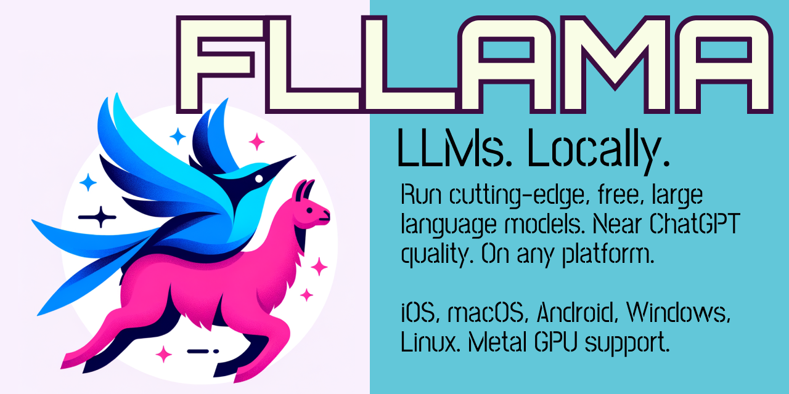

- Everywhere: web, iOS, macOS, Android, Windows, Linux.
- Fast: exceeds average reading speed on all platforms except web.
- Private: No network connection, server, cloud required.
- Forward compatible: Any model compatible with llama.cpp. (so, every model.)
- Full OpenAI compatability: chat messages, multimodal/image support via LLaVa models, and function calling. (constrain outputs to valid JSON based on a JSON schema) 
- Bare metal interface: call LLMs without being constrained to a chat implementation.
- Use with FONNX for RAG
  - Combine with [FONNX](https://github.com/Telosnex/fonnx) to have a full retrieval-augmented generation stack available on all platforms.

## CI builds
| Platform     | Status |
|--------------|--------|
| __Android__  | [](https://codemagic.io/app/661bdc0af8dd02f68c5475b7/android-build/latest_build) |
| __iOS__  | [](https://codemagic.io/app/661bdc0af8dd02f68c5475b7/ios-build/latest_build) |
| __Linux__    | [](https://codemagic.io/app/661bdc0af8dd02f68c5475b7/linux-build/latest_build) |
| __macOS__ | [](https://codemagic.io/app/661bdc0af8dd02f68c5475b7/macos-build/latest_build) |
| __Web__  | [](https://codemagic.io/app/661bdc0af8dd02f68c5475b7/web-build/latest_build) |
| __Windows__  | [](https://codemagic.io/app/661bdc0af8dd02f68c5475b7/windows-build/latest_build) |

## Recent updates
### 26 Feb 2024
- Web is now based on WASM compiled from FLLAMA itself, rather than just llama.cpp, guaranteeing native/web parity.
- Tokenizing strings based on the model is 1000x faster, via caching the model. Went from O(300 ms) on native only to O(0.2 ms) on web, O(0.00001 ms) on native. This enables calculating what strings will be in context based on the context size.
- Method renames for consistency, correctness, and clarity. (ex. remove *Async from names, because all methods are async; rename `fllamaChatCompletionAsync` to `fllamaChat`)
- Document methods and updated example. TL;DR: Use `fllamaChat` unless you're doing something funny with LLMs that isn't user-facing, it will act like a true text completion engine instead of a chatbot.

## Integrate
- Add this to your package's pubspec.yaml file:
```yaml
dependencies:
  fllama:
    git:
      url: https://github.com/Telosnex/fllama.git
      ref: main
```
- Run inference:
```dart
import 'package:fllama/fllama.dart';

String latestResult = "";

final request = OpenAiRequest(
  maxTokens: 256,
  messages: [
    Message(Role.system, 'You are a chatbot.'),
    Message(Role.user, messageText),
  ],
  numGpuLayers: 99, /* this seems to have no adverse effects in environments w/o GPU support, ex. Android and web */
  modelPath: _modelPath!,
  mmprojPath: _mmprojPath,
  frequencyPenalty: 0.0,
  // Don't use below 1.1, LLMs without a repeat penalty
  // will repeat the same token.
  presencePenalty: 1.1,
  topP: 1.0,
  // Proportional to RAM use. 
  // 4096 is a good default. 
  // 2048 should be considered on devices with low RAM (<8 GB)
  // 8192 and higher can be considered on device with high RAM (>16 GB)
  // Models are trained on <= a certain context size. Exceeding that # can/will lead to completely incoherent output.
  contextSize: 2048,
  // Don't use 0.0, some models will repeat the same token.
  temperature: 0.1,
  logger: (log) {
    // ignore: avoid_print
    print('[llama.cpp] $log');
  },
);
fllamaChat(request, (response, done) {
    setState(() {
      latestResult = response;
    });
});
```
## Tips & Tricks
### Web
  Web uses a wllama/WebGPU runtime. In a Flutter web build, the fllama build hook installs it in `web/native_prebuilt/fllama/` of the app, and fllama loads it at the first call; the app needs no script tag (native_prebuilt ADR 002). Other embedders serve those files and set `FllamaWeb.runtimeUri`.
  For best performance, serve the app with cross-origin isolation enabled so the multi-threaded WebAssembly backend can run.

  To check the web runtime locally:
  ```sh
  dart run native_prebuilt:web install-dev
  scripts/check_web_assets.sh
  ```
### Recommended models
  3 top-tier open models are in the [fllama HuggingFace repo](https://huggingface.co/telosnex/fllama/tree/main).
  - __Stable LM 3B__ is the first LLM model that can handle RAG, using documents such as web pages to answer a query, on *all* devices. 
  > Mistral models via [Nous Research](https://nousresearch.com/).
    They trained and finetuned the Mistral base models for chat to create the OpenHermes series of models.
  - __Mistral 7B__ is best on 2023 iPhones or 2024 Androids or better.
    It's about 2/3 the speed of Stable LM 3B and requires 5 GB of RAM.
  - __Mixtral 8x7B__ should only be considered on a premium laptop or desktop,
    such as an M-series MacBook or a premium desktop purchased in 2023
    or later. It's about 1/3 the speed of Stable LM 3B and requires 
    26 GB of RAM.
### RAM Requirements
  Roughly: you'll need as much RAM as the model file size.
  If inference runs on CPU, that much regular RAM is required.
  If inference runs on GPU, that much GPU RAM is required.
### Download files from HuggingFace at runtime
  HuggingFace, among many things, can be thought of as GitHub for AI models.
  You can download a model from HuggingFace and use it with fllama.
  To get a download URL at runtime, see below.
  ```dart
  String getHuggingFaceUrl(
    {required String repoId,
    required String filename,
    String? revision,
    String? subfolder}) {
  // Default values
  const String defaultEndpoint = 'https://huggingface.co';
  const String defaultRevision = 'main';

  // Ensure the revision and subfolder are not null and are URI encoded
  final String encodedRevision =
      Uri.encodeComponent(revision ?? defaultRevision);
  final String encodedFilename = Uri.encodeComponent(filename);
  final String? encodedSubfolder =
      subfolder != null ? Uri.encodeComponent(subfolder) : null;

  // Handle subfolder if provided
  final String fullPath = encodedSubfolder != null
      ? '$encodedSubfolder/$encodedFilename'
      : encodedFilename;

  // Construct the URL
  final String url =
      '$defaultEndpoint/$repoId/resolve/$encodedRevision/$fullPath';

  return url;
}
```

# Licensing

FLLAMA is licensed under a dual-license model.

The code as-is on GitHub is licensed under GPL v2. That requires distribution of the integrating app's source code, and this is unlikely to be desirable for commercial entities. See LICENSE.

Commercial licenses are also available. Contact info@telosnex.com. Expect very fair terms: our intent is to charge only entities, with a launched app, making a lot of money, with FLLAMA as a core dependency. The base agreement is here: https://github.com/lawndoc/dual-license-templates/blob/main/pdf/Basic-Yearly.pdf

# llama.cpp source layout and update process

fllama has two llama.cpp delivery paths:

- **Native platforms** compile the vendored source tree in this repo:
  ```text
  src/llama.cpp
  ```
- **Web** uses wllama (`wllama/index.js`, `wllama/wasm/wllama.{js,wasm}`).
  The release workflow builds it with `tool/build_web.dart` from wllama and
  llama.cpp at the commits of `web_build/wllama.json`, with
  `web_build/wllama.patch`. `native_artifacts/web.json` pins the files.

To keep native and web matched, the llama.cpp commit of `web_build/wllama.json`
is the commit of `src/llama.cpp`.

## Refresh native llama.cpp from wllama

```sh
export FLLAMA=/Users/jpo/dev/fllama
export WLLAMA=/Users/jpo/dev/ngxson_wllama

cd "$FLLAMA"
git status --short

# Dry run first. Review every changed/deleted file.
rsync -nrc --delete \
  --exclude='.git/' \
  --exclude='build/' \
  --exclude='FLLAMA_LLAMA_CPP_DROP.txt' \
  "$WLLAMA/llama.cpp/" \
  "$FLLAMA/src/llama.cpp/"

# If the dry run is sane, do the copy.
rsync -a --delete \
  --exclude='.git/' \
  --exclude='build/' \
  --exclude='FLLAMA_LLAMA_CPP_DROP.txt' \
  "$WLLAMA/llama.cpp/" \
  "$FLLAMA/src/llama.cpp/"
```

Then update the native build metadata/documentation:

- `src/CMakeLists.txt`: update `LLAMA_BUILD_COMMIT`.
- `src/llama.cpp/FLLAMA_LLAMA_CPP_DROP.txt`: record where the drop came from and why.

If the wllama `llama.cpp` directory is a real Git checkout, use:

```sh
git -C "$WLLAMA/llama.cpp" rev-parse --short HEAD
```

If it is a copied/submodule tree without `.git` metadata, use the recorded source commit in `FLLAMA_LLAMA_CPP_DROP.txt` or the wllama submodule gitlink:

```sh
git -C "$WLLAMA" ls-files -s llama.cpp
```

Clean stale native build outputs before validating:

```sh
cd "$FLLAMA"
rm -rf src/build example/build
cmake -S src -B src/build -DCMAKE_BUILD_TYPE=Release
cmake --build src/build -j
```

Then validate through a Flutter host, for example:

```sh
cd "$FLLAMA/example"
flutter build macos --debug
```

## Rebuild the web wllama artifacts

Change `web_build/wllama.json` or `web_build/wllama.patch`, then run the native
release workflow: its web job builds the files and its browser test loads a
model with them. For a local build, run the script in the pinned image (see
the comment at the top of `tool/build_web.dart`), then:

```sh
dart run native_prebuilt:web install-dev --from /tmp/fllama_web
node --check lib/web/fllama_web_init.js
scripts/check_web_assets.sh
flutter test --platform chrome test/web_runtime_test.dart
```

After a change to `lib/web/fllama_web_init.js`, run
`dart run native_prebuilt:web stamp`.

# Web development
- The web example uses wllama's server backend and requires cross-origin isolation for SharedArrayBuffer/pthreads.
- From the example directory, run debug mode with:
  ```sh
  flutter run -d chrome --cross-origin-isolation
  ```
- Or run a release-style local build with the bundled header-setting server:
  ```sh
  flutter build web
  node web/server.js
  ```
- `flutter run -d web` is not a valid Flutter device id; use `chrome` for an auto-launched browser or `web-server` if you want to open the URL yourself.
- If your Flutter version does not support `--cross-origin-isolation`, pass the headers explicitly:
  ```sh
  flutter run -d chrome \
    --web-header=Cross-Origin-Opener-Policy=same-origin \
    --web-header=Cross-Origin-Embedder-Policy=require-corp
  ```

# FFI development
- When changes are made to C++ bindings, run `flutter pub run ffigen --config ffigen.yaml` to make them available in Dart.
- `rm -rvf Podfile.lock && rm -rvf Podfile && rm -rvf Pods && flutter clean`
^ run in example/macos / example/ios when upgrading cpp files, or when getting cryptic errors about build cache.

